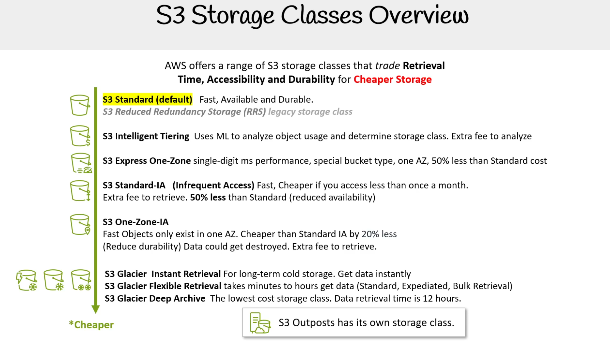

# S3

## Object storage
A data storage architecture that manages data as objects



### S3 Objects
Consist of:
- **Key**: name of the object (cannot exceed 1024 bytes)
- **Value**: the data 
- **Version ID**: version of the object (if versioning enabled)
- **Metadata**: additional info attached
- **Etags**: detect when the contents of an object has changed
- **Checksums**: ensures the integrity (CRC, CRC32C, SHA1, SHA256)
- **Prefixes**: simulates the file-system folders in a flat hierarchy
- **Tags**: benefits resource tagging at the object level
- **Object Locking**: makes data files immutable
- **Object Versioning**: have multiple versions of a data file

### S3 Bucket
Buckets hold objects. Buckets can also have folders which in turn hold objects.

#### Naming Convention:
- 3-63 characters long
- Only lowercase letters, numbers, dots (`.`) and hyphens (`-`)
- Begin and end with a letter or number
- Can't be formatted as IP addresses or contain adjacent periods (`..`)
- Restricted prefixes: `xn--`, `sthree` or `sthree-configurator`
- Restricted suffixes: `-s3aliases` or `--ol-s3`
- Must be unique across all AWS accounts in all AWS regions within a partition (`aws`, `aws-cn`, `aws-us-gov`) -> a name can't be reused in the same partition until the original bucket is deleted

#### Limitations and Restrictions
- Default create 100 byckets -> create a service request (request submit to AWS) to increase to 1000 buckets
- Empty a bucket first before you can delete it
- No max bucket size and no limit to the number of projects in a bucket:
  - Files can be between 0 - 5 TBs, files larger than 100 MB should use multi-part upload
  - S3 for AWS Outposts has limits
- Get, Put, List and Delete operations are designed for high availability   
  - Create, Delete or configuration operations should be run less often

#### Bucket Types
- General purpose buckets (default and most commonly used for S3 bucket type): organize data in a flat hierarchy, compatible with all S3 storage classes except S3 Express One Zone, default limit is 10000 per account
- Directory buckets (design for applications needing extremely fast, consistent performance): organize data in folder style hierarchy, only for use with S3 Express One Zone storage class (ultra-low latency, single-digit ms PUT/GET), default limit is 100 per account

#### Bucket Folders
S3 general purpose buckets do not have true folders. When you create a folder in S3 Console, Amazon S3 creates a zero-byte S3 object with a name that ends with `/`, doesn't include metadata, permissions, or anything, they can't be full or empty. S3 folders aren't moved, S3 objects containing the same prefix are renamed

## Request Styles

- Virtual hosted-stype request - bucket name is a subdomain on the host:
    ```
    DELETE /puppy.jpg HTTP/1.1
    Host: examplebucket.s3.us-west-2.amazonaws.com
    ```
- Path-style request - bucket name is in the request path (discontinued in the future):
    ```
    DELETE /examplebucket/puppy.jpg HTTP/1.1
    Host: s3.us-west-2.amazonaws.com
    ```
- To force AWS CLI to use Virtual hosted-style requests, you need to globally configure the CLI
    ```
    aws configure set s3.addressing_style virtual
    ```